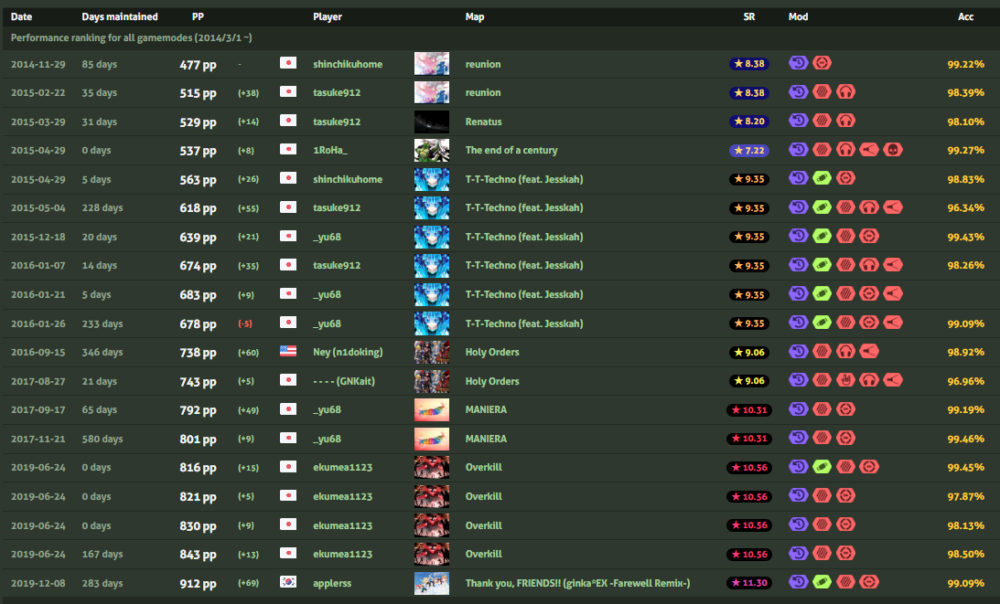

# osu!taiko PP Record 

This repository documents the historical progression of top osu!taiko performance point (PP) records.  
All records are manually collected from web archives, osu! comments, social media posts, and community contributions.

🌐 **Live Website:**  
https://calmeel.github.io/osu-taiko-pp-record-history/

## 📖 Purpose

The goal of this project is to preserve the historical context of osu!taiko PP achievements over time, including:

- Highest PP values
- Player information
- Map details (SR, Map Link)
- Mods used
- Replay availability
- Dates and record eras
- Days maintained for each record

This information is not officially tracked anywhere and would otherwise be lost as older plays become buried.

## 🔄 Data Source & Maintenance

Records are manually collected through:

- osu! web archives
- replay uploads
- screenshots and video evidence
- community posts and comments
- historical leaderboard captures

Fields such as **Days maintained** are automatically updated daily via GitHub Actions.

## 📁 Evidence & Verification

This repository maintains a companion folder named `evidence/` which stores
primary sources used to verify the accuracy of historical PP data.

These include:

- screenshots of plays
- player comments and self-reports
- leaderboard snapshots
- metadata notes (as `.md`)

The purpose of this folder is to preserve **verifiable historical context**
for cases where public data has been deleted, made private, or otherwise became
difficult to retrieve in the future.

Community submissions are welcome — especially if you possess historical data
that is currently missing from the archive.

For Star Rating (SR) sources and calculation methods, see
[Star Rating (SR) calculation methodology](SR_CALCULATION.md).

## 🛡 Asset Ownership & Use Policy

Different assets within this repository have different ownership. The following clarifies usage and intent:

### **→ Beatmap Jacket Art**
Jacket images remain the property of their respective copyright holders.  
They are included solely for **identification, historical context, and archival purposes**.  
This project does not claim ownership or redistribution rights to these assets.

### **→ Replay Files (.osr)**
Replay files are included for **verification and archival purposes**.  
Players retain ownership of their own gameplay data.  
If you are the player and would prefer your replay not to be included, I will remove it immediately upon request.

### **→ Platform Logos (YouTube / X / Reddit / osu!)**
These logos are recognized trademarks of their respective owners.  
They are used exclusively to **indicate link destinations**, and **no affiliation or endorsement is implied**.

### **→ Mod Icons & Flag Icons**
Mod and flag icons originate from the open-source project `osu-web` (MIT licensed).  
Source: https://github.com/ppy/osu-web  
License: MIT  
These are used under the terms of that license with proper attribution.

### Fonts

This project uses the **Aller** typeface for headings and UI elements.

Aller is © Dalton Maag Ltd and is used under its respective license.  
The full license text is included in this repository at:

`fonts/Aller Font License.txt`

Please refer to that file for the exact terms of use before reusing the font files outside of this project.

## 📘 Licensing

This repository contains multiple asset types with distinct ownership.  
To avoid accidental commercial re-use and to protect rights holders, this archive is distributed under:

> **CC BY-NC-SA 4.0 — Attribution, Non-Commercial, Share-Alike**

This license applies to:
- data formatting
- HTML/CSS/JS
- documentation
- research notes

Asset-specific exceptions:

| Asset Type | License / Ownership |
|---|---|
| Jacket art | Copyright holders (not redistributed for commercial use) |
| Replay files | Players (archival only) |
| Platform logos | Trademark owners |
| Mod/flag icons | MIT (from `osu-web`) |
| Fonts (Aller) | © Dalton Maag Ltd. — License included in `fonts/Aller Font License.txt` |
| Other assets | © Their respective owners |

For full license details, see: LICENSE, NOTICE, and ATTRIBUTION.md

## 📑 Legal & Trademark Notes

- **No ownership is transferred or implied**
- **No assets are monetized**
- **No endorsement is implied**
- **External assets remain under their original Terms of Service**
- **Content is shown only as necessary for documentation and verification**

This repository and its maintainer are not affiliated with osu!, ppy, or any platform referenced within this project.

## 🧾 Removal & Correction Requests

If you:
- are the rights holder of a linked video or media,
- are the creator of a beatmap jacket,
- are the player of a replay file,
- or are the copyright holder of any relevant asset,

and would prefer your content not to be included, please contact me and I will take immediate action without dispute.

For removal or correction requests, contact:

> Discord: `vanity8`

## 📜 Disclaimer

This is an unofficial historical project not affiliated with osu! or ppy.  
All replays and assets belong to their respective owners and are preserved strictly for archival and documentation purposes.

## 📬 Contact

Discord id: **vanity8**  
(If you have replays, missing plays, or corrections, please message me!)

## 🤝 Contributions

The following individuals contributed to this project through verification, methodology, and data collection support:

- **shinchikuhome**, **Majimanjiwwwww**  
  – Verification of personal performance records

- **Eriha**  
  – Provision of replay data 

- **Anders8KJS**  
  – Suggestions on replay data collection methodologies

- **Hoshino1 / puk06 / ぷこるふ**  
  – Suggestions on Star Rating (SR) calculation methodologies
